# Barbershop-Appointments-Management

A full-stack web application for booking and managing **barbershop services and appointments**.
Built as a **university project**, it covers authentication, role-based access, service management, scheduling and testing, on a layered backend with dependency injection.


## Project Summary

Barbershop VT has two kinds of accounts:

**Customers** can:
- Register, log in and browse the price list.
- Book an appointment: pick a service, a day from the next two weeks and an open time slot, and add an optional note for the barber.
- See their bookings split into **Upcoming** and **Past**, with a status on each (Pending, Confirmed, Completed, Cancelled).
- Cancel their own upcoming bookings.

**Admins** can:
- Create, edit and delete services, with a live preview of how each one reads on the price list.
- See every booking in the shop, including customer names and notes.
- Confirm or cancel upcoming bookings, and restore cancelled ones.
- Mark past visits as **done** or as a **no-show**.

The rules are enforced on the server as well as in the UI:
- A customer can only cancel their own bookings. They can't confirm them or change who they belong to.
- Overlapping bookings are rejected.
- Notes are limited to 500 characters.
- The API never sends password hashes.
- When a session expires, the frontend logs you out and returns you to the login page.

Both backend and frontend are fully implemented:
- **Backend:** Node.js + Express + Prisma + Awilix (dependency injection)
- **Frontend:** React + Vite + Tailwind CSS + Framer Motion + Axios + React Router
- **Database:** SQLite (Prisma ORM)
- **Authentication:** JSON Web Tokens (JWT) + bcrypt
- **Validation:** express-validator
- **Testing:** Jest + Supertest (integration tests) and a Postman API collection


## Tech Stack

**Frontend**: React (Vite), React Router, Axios, Tailwind CSS v4, Framer Motion, react-hot-toast
<br>
**Backend**: Node.js, Express.js, Awilix (DI), Prisma ORM, JWT, bcrypt
<br>
**Database**: SQLite
<br>
**Testing**: Jest + Supertest (integration) & Postman (E2E)


## Project Structure

### Backend (`/barber-backend`)
- app.js # Express app with DI setup (Awilix)
- index.js # Entry point, server port
- container.js # Awilix dependency container
- routes/ # Express routes
- controllers/ # Controllers (resolved through the container, no direct service imports)
- services/ # Business logic (ownership, status rules, overlap checks)
- repositories/ # Database access (via Prisma)
- middleware/ # JWT auth and admin-only guard
- validators/ # express-validator rules
- prisma/ # Prisma schema & migrations
- tests/ # Jest integration tests

### Frontend (`/`)
- Screenshots/ # Screenshots of the running app
- postman/ # Exported Postman collection + test results
- src/components/ # Navbar, Footer, SlotPicker, ServiceRow, and ui/ primitives (Button, Field, StatusBadge…)
- src/context/ # AuthContext (login/register state)
- src/pages/ # Home, Services, Appointments, Login, Register, ServiceForm
- src/services/ # Axios instance (adds the token, handles expired sessions)
- src/lib/ # Shop details (opening hours, price formatting) and API error helpers
- src/App.jsx, src/main.jsx # Router + layout
- src/index.css # Tailwind CSS theme tokens
- DESIGN.md # Design system notes


## How to Run the Project

### Setup & Run the Backend

```bash
cd barber-backend
npm install
```

Create `barber-backend/.env`:

```
DATABASE_URL="file:./dev.db"
JWT_SECRET="any-long-random-string"
```

Then:

```bash
npx prisma migrate dev
npm run dev
```

The API runs on `http://localhost:4000`.

### Setup & Run the Frontend

```bash
npm install
npm run dev
```

### Making an admin

Every new account is a customer. To make one an admin, open Prisma Studio and change that user's `role` to `ADMIN`:

```bash
cd barber-backend
npx prisma studio
```

### Running the tests

```bash
cd barber-backend
npm test
```

## Screenshots

### Guest

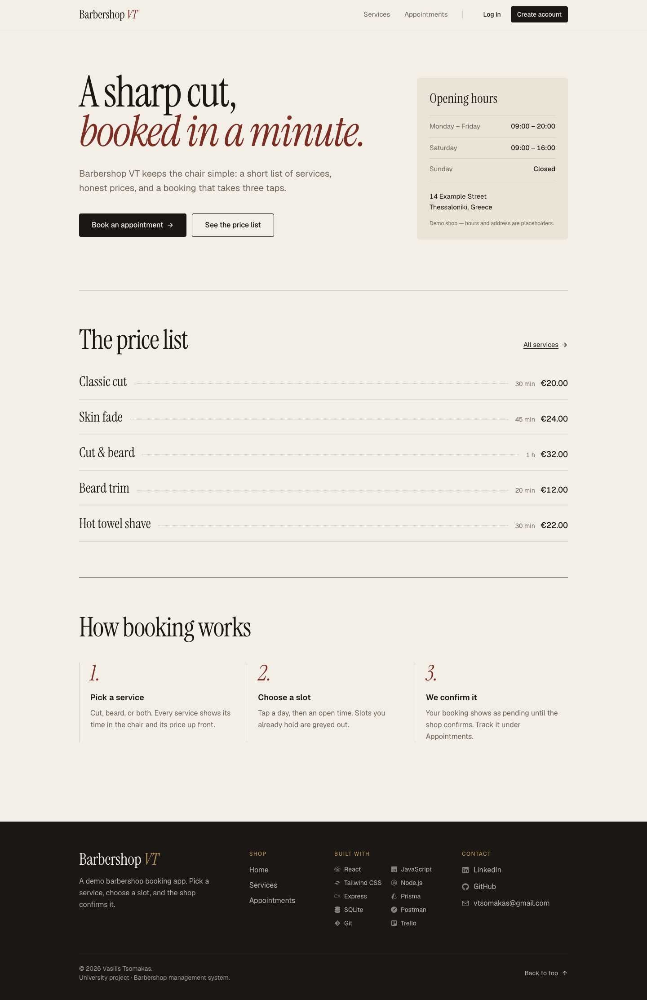
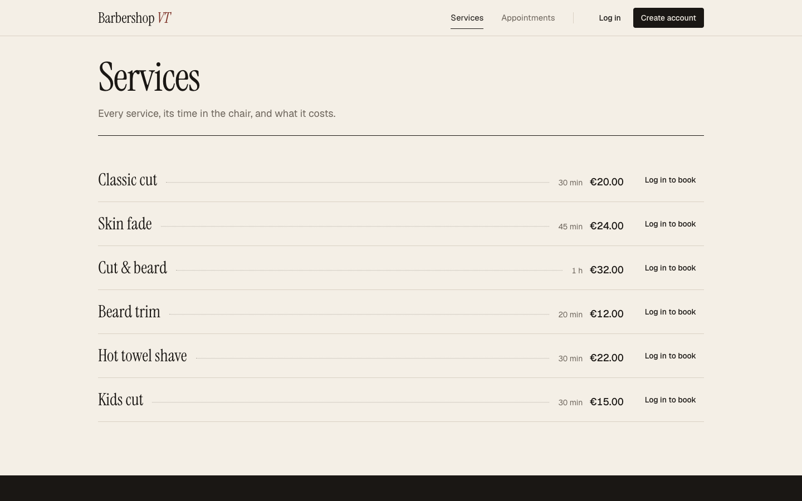

### Login
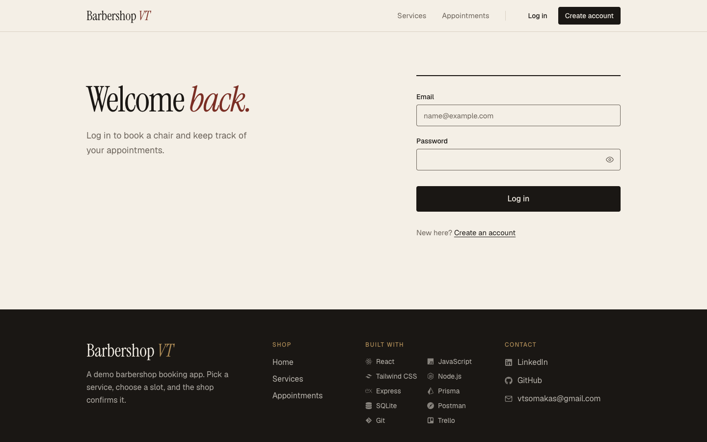

### Register
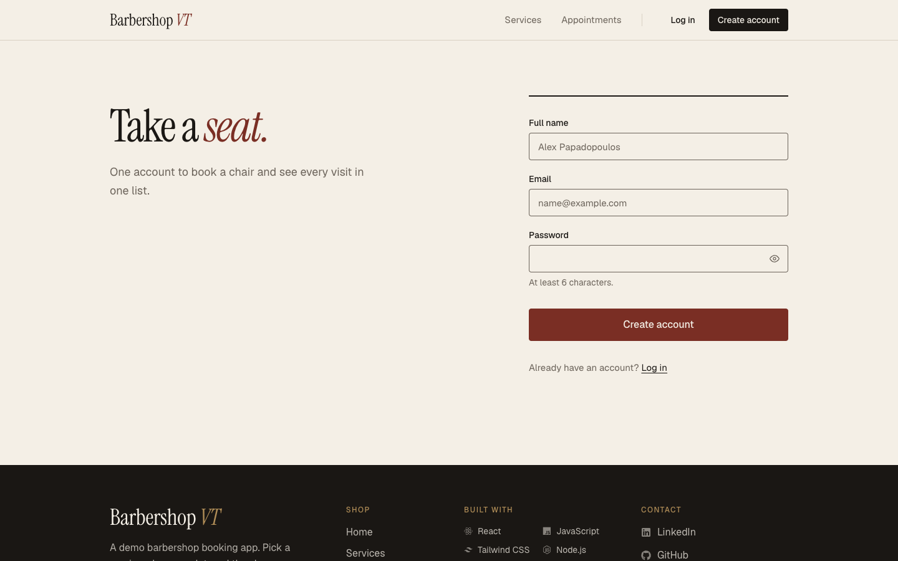

### Customer logged in

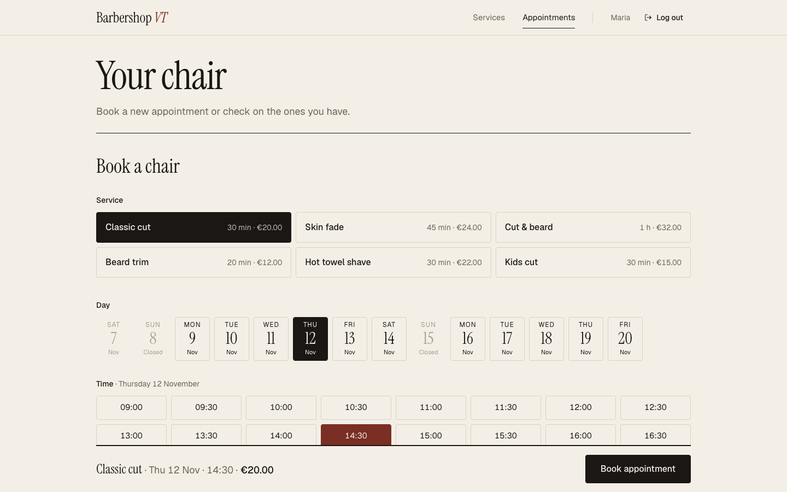
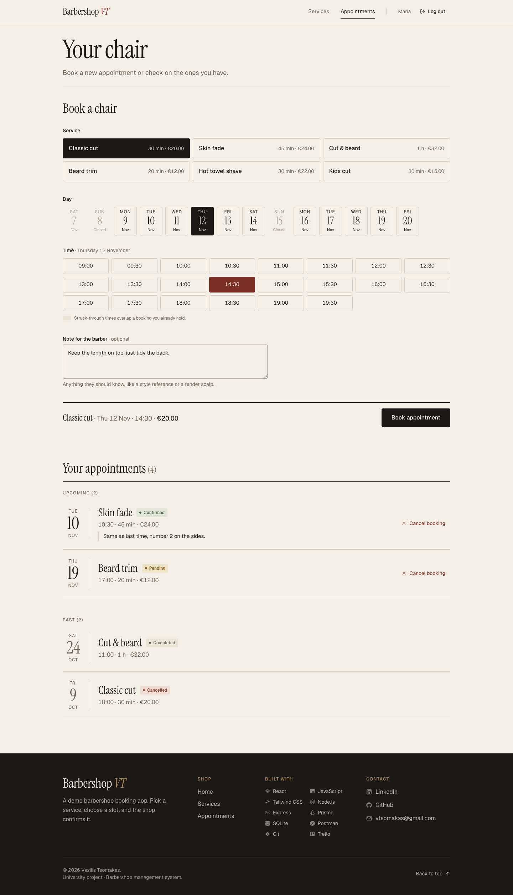
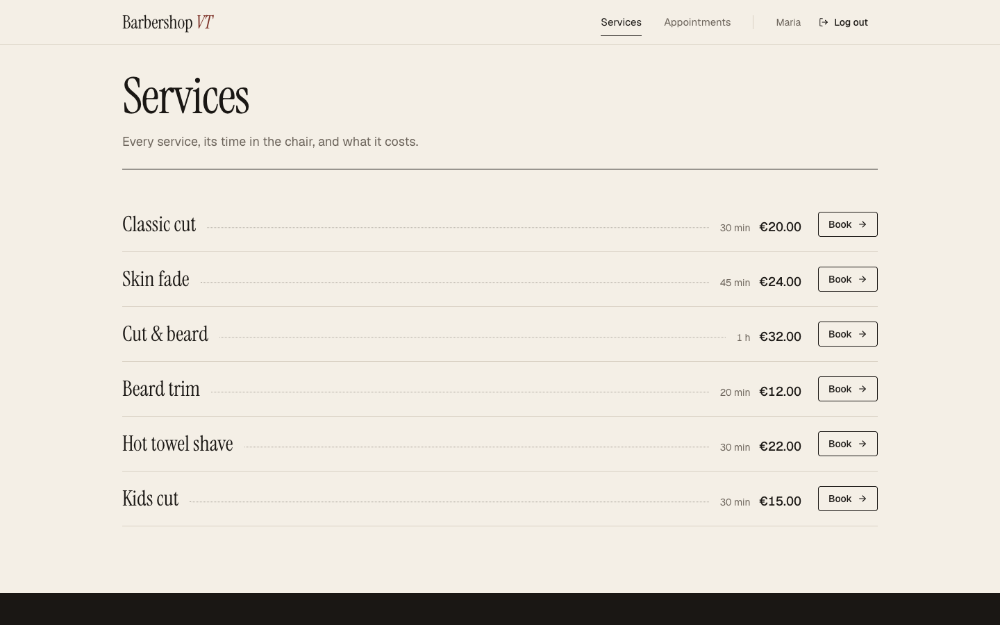

### Admin logged in

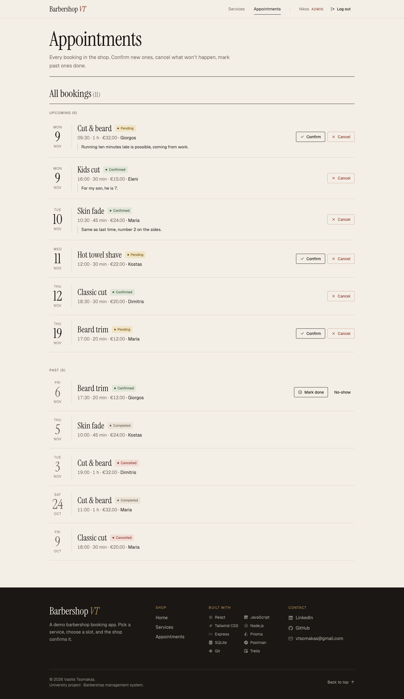
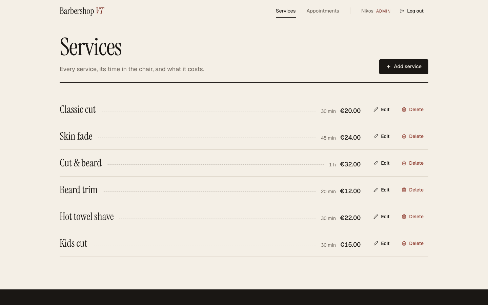
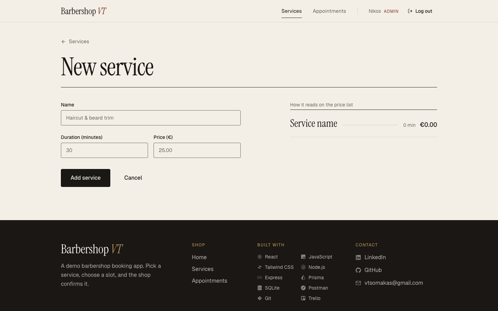
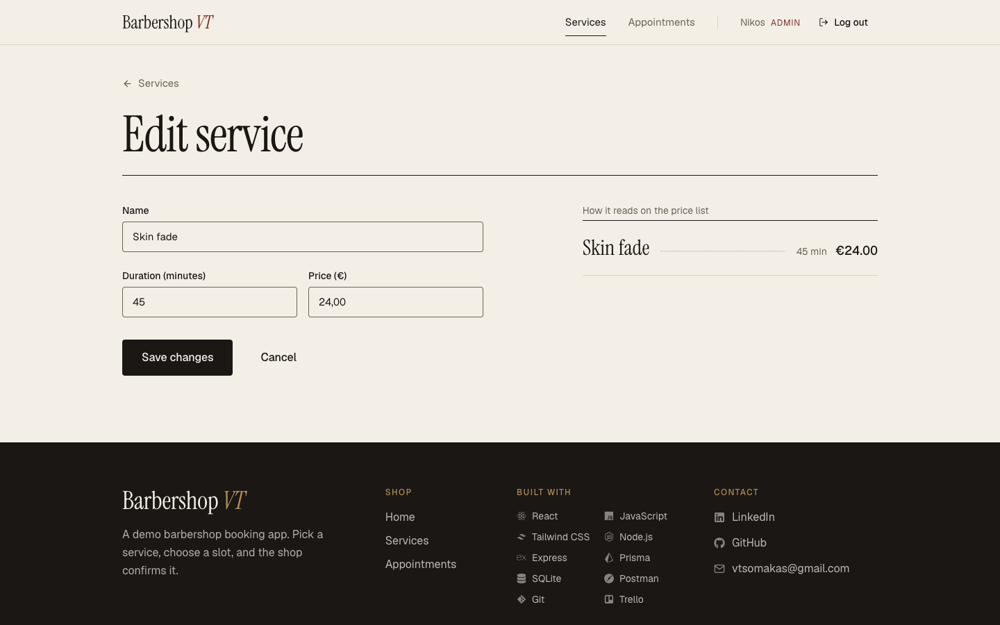
